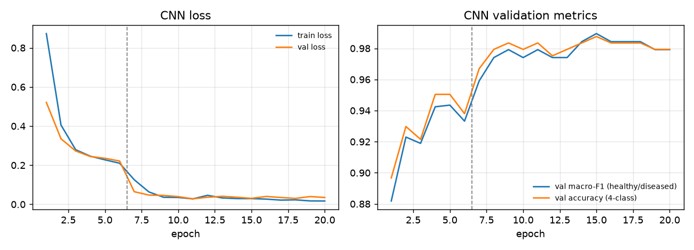
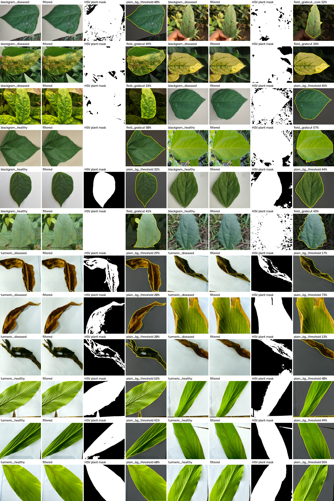
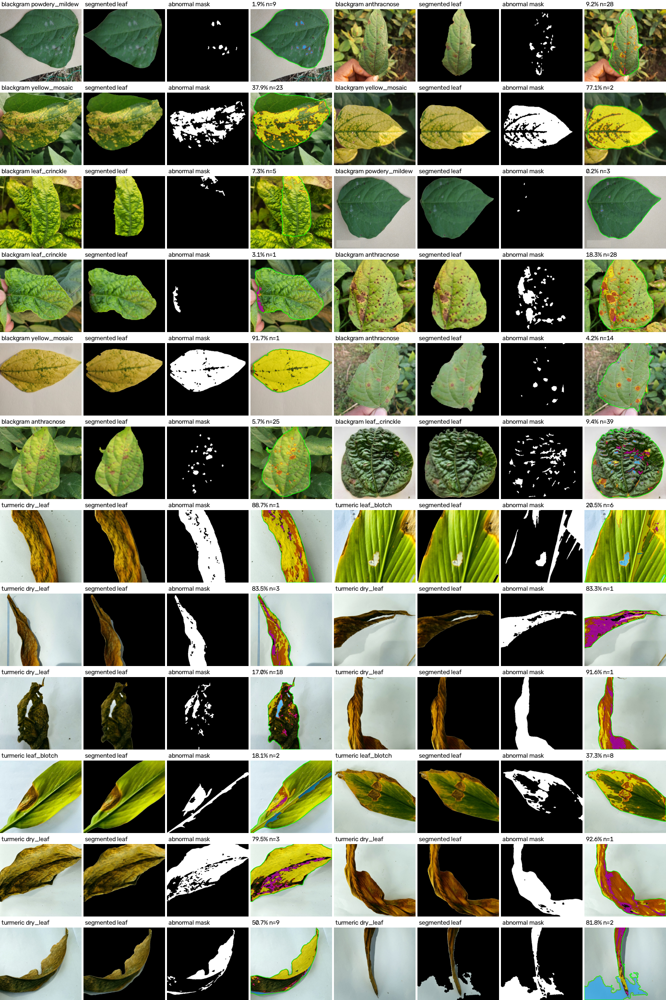
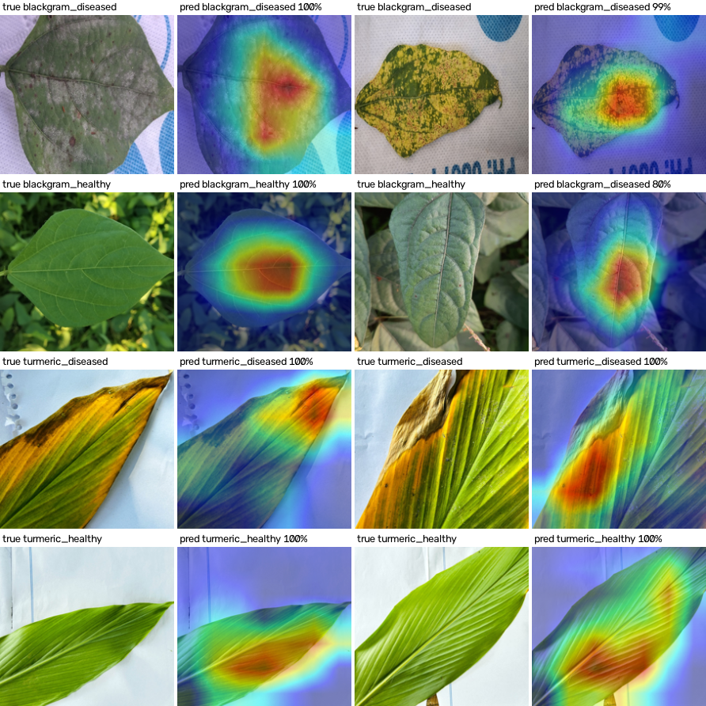
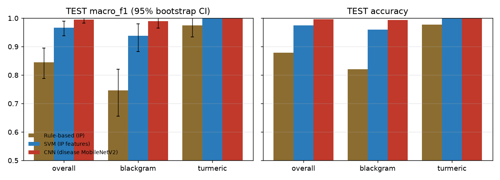
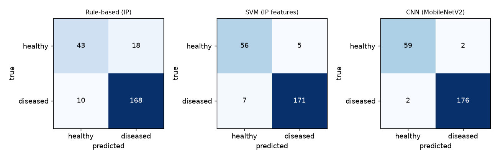
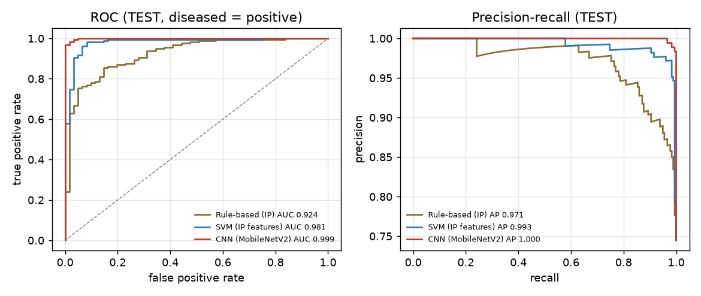
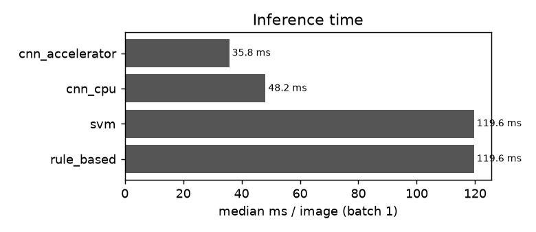
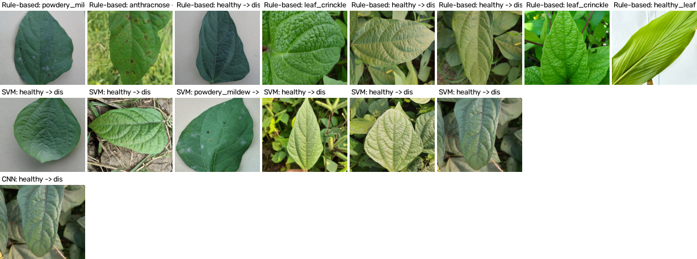
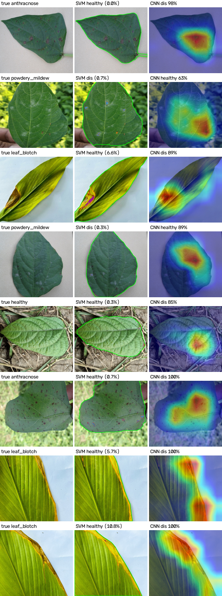

# Image Processing + CNN for Disease Detection in Turmeric and Black Gram

> Generated by `scripts/make_report.py` from files in `results/` and `data/processed/`. No number in this report is typed by hand; `results/report_numbers.json` lists the source of each.

**Research question.** Can conventional digital image-processing techniques identify disease-related characteristics in turmeric and black gram leaves, and how does their performance compare with a CNN-based approach?

## Data

Public datasets (Mendeley Data, sha256-verified on download; see README):

- **Black gram:** Talasila et al., Black gram Plant Leaf Disease (BPLD) dataset, Data in Brief 45 (2022) 108725, doi:10.17632/zfcv9fmrgv.3
- **Turmeric:** A data-driven approach to turmeric disease detection: Dataset for plant condition classification, Data in Brief 59 (2025) 111435, doi:10.17632/g46dvrcvwn.2 - original images only (the pre-augmented archive is not used).

| Crop | Original class | Label | Images | Train | Val | Test |
|---|---|---|---|---|---|---|
| blackgram | anthracnose | diseased | 230 | 169 | 31 | 30 |
| blackgram | healthy | healthy | 221 | 155 | 34 | 32 |
| blackgram | leaf_crinckle | diseased | 152 | 108 | 23 | 21 |
| blackgram | powdery_mildew | diseased | 180 | 115 | 31 | 34 |
| blackgram | yellow_mosaic | diseased | 224 | 158 | 33 | 33 |
| turmeric | dry_leaf | diseased | 203 | 150 | 28 | 25 |
| turmeric | healthy_leaf | healthy | 197 | 138 | 30 | 29 |
| turmeric | leaf_blotch | diseased | 199 | 132 | 32 | 35 |

Total readable leaf images: 1606 (unreadable: 0). Rhizome/root classes of the turmeric dataset are excluded.

**Leakage control.** Near-duplicates are clustered with perceptual hashes at two resolutions over all flip/rotation variants plus consecutive-file-number (burst shot) grouping; whole clusters are assigned to train/val/test (stratified by crop x label, seed 42). Clusters: 1548, of which 50 contain more than one image; clusters spanning two splits: 0.

**Capture conditions.** Share of images photographed on a plain card/paper/cloth (Stage 1 plain-background mode): 
- blackgram healthy: 67 of 221
- blackgram diseased: 203 of 786
- turmeric healthy: 197 of 197
- turmeric diseased: 401 of 402

## Methods

```
              LEAF IMAGE
                  |
        +---------+---------+
        v                   v
  IMAGE PROCESSING         CNN
        v                   v
  regions + features   learned features
        v                   v
  rule score / SVM     CNN classifier
        +---------+---------+
                  v
          HEALTHY / DISEASED
```

**Stage 1 - digital image processing (core).** Resize, median + Gaussian denoising, CLAHE on L*; leaf segmentation in two modes chosen from the image border (plain background: k-means background colour model in Lab + Otsu threshold on colour distance; field background: GrabCut with a centre prior); morphology and dominant-component selection with hole filling. Abnormal regions: yellow / brown / dark / pale colour rules relative to each leaf's own green reference, hysteresis growth, opening/closing and connected components. Features (listed in `results/feature_list.txt`): colour statistics over leaf and lesions (RGB/HSV/Lab), abnormal-colour %, GLCM contrast / energy / homogeneity / correlation / dissimilarity, edge density, lesion count / area / perimeter / circularity / mean and max size, leaf solidity. Decisions: (a) a fixed-weight rule score over affected-%, lesion count, abnormal-colour % and GLCM contrast with a per-crop threshold chosen on VAL; (b) an RBF SVM tuned by grouped cross-validation on TRAIN.

**Stage 2 - CNN.** mobilenet_v2 pretrained on ImageNet, new 4-class head (turmeric/black gram x healthy/diseased), train-only augmentation, class-weighted cross-entropy, AdamW, head-only stage then fine-tuning of the last blocks, early stopping on VAL macro-F1. Epochs run: 20; best epoch 15 (VAL macro-F1 0.989); training time 5.6 min on `mps`. P(diseased) = sum of the two diseased-class probabilities.



## Stage 1 checks

- Segmentation: 99.0% of 100 random train/val images give a single dominant leaf mask covering 5% to 95% of the frame.
- Abnormal-region detection (240 train/val images): mean affected area 1.88% on healthy vs 39.63% on diseased leaves.





## Results

### Stage 1 decisions

**Rule-based score - VAL**

| Scope | n | Accuracy | Precision | Recall | F1 | Macro-F1 | ROC-AUC |
|---|---|---|---|---|---|---|---|
| overall | 242 | 0.913 | 0.915 | 0.972 | 0.943 | 0.882 | 0.914 |
| blackgram | 152 | 0.895 | 0.905 | 0.966 | 0.934 | 0.834 | 0.893 |
| turmeric | 90 | 0.944 | 0.937 | 0.983 | 0.959 | 0.936 | 0.975 |

**Rule-based score - TEST**

| Scope | n | Accuracy | Precision | Recall | F1 | Macro-F1 | ROC-AUC |
|---|---|---|---|---|---|---|---|
| overall | 239 | 0.883 | 0.903 | 0.944 | 0.923 | 0.839 | 0.924 |
| blackgram | 150 | 0.840 | 0.873 | 0.932 | 0.902 | 0.737 | 0.864 |
| turmeric | 89 | 0.955 | 0.967 | 0.967 | 0.967 | 0.949 | 0.998 |

**SVM - VAL**

| Scope | n | Accuracy | Precision | Recall | F1 | Macro-F1 | ROC-AUC |
|---|---|---|---|---|---|---|---|
| overall | 242 | 0.955 | 0.972 | 0.966 | 0.969 | 0.942 | 0.986 |
| blackgram | 152 | 0.928 | 0.957 | 0.949 | 0.953 | 0.897 | 0.965 |
| turmeric | 90 | 1.000 | 1.000 | 1.000 | 1.000 | 1.000 | 1.000 |

**SVM - TEST**

| Scope | n | Accuracy | Precision | Recall | F1 | Macro-F1 | ROC-AUC |
|---|---|---|---|---|---|---|---|
| overall | 239 | 0.950 | 0.972 | 0.961 | 0.966 | 0.935 | 0.981 |
| blackgram | 150 | 0.940 | 0.958 | 0.966 | 0.962 | 0.910 | 0.963 |
| turmeric | 89 | 0.966 | 1.000 | 0.950 | 0.974 | 0.963 | 1.000 |

SVM hyperparameters (grouped CV on TRAIN): C = 30, gamma = 0.01; CV macro-F1 0.934. Rule thresholds from VAL: black gram 0.110, turmeric 0.235.

### CNN

**CNN healthy/diseased - VAL**

| Scope | n | Accuracy | Precision | Recall | F1 | Macro-F1 | ROC-AUC |
|---|---|---|---|---|---|---|---|
| overall | 242 | 0.992 | 1.000 | 0.989 | 0.994 | 0.989 | 0.999 |
| blackgram | 152 | 0.987 | 1.000 | 0.983 | 0.991 | 0.981 | 0.999 |
| turmeric | 90 | 1.000 | 1.000 | 1.000 | 1.000 | 1.000 | 1.000 |

**CNN healthy/diseased - TEST**

| Scope | n | Accuracy | Precision | Recall | F1 | Macro-F1 | ROC-AUC |
|---|---|---|---|---|---|---|---|
| overall | 239 | 0.983 | 0.989 | 0.989 | 0.989 | 0.978 | 0.999 |
| blackgram | 150 | 0.973 | 0.983 | 0.983 | 0.983 | 0.960 | 0.998 |
| turmeric | 89 | 1.000 | 1.000 | 1.000 | 1.000 | 1.000 | 1.000 |

4-class (crop x state) TEST accuracy 0.983, macro-F1 0.980; crop identification accuracy 1.000. Mean confidence when correct 0.993 vs when wrong 0.818.



## Comparison: image processing vs CNN (identical TEST split)

| Method | Scope | n | Accuracy | Macro-F1 [95% CI] | Precision | Recall (diseased) | Recall (healthy) | ROC-AUC |
|---|---|---|---|---|---|---|---|---|
| Rule-based (IP) | overall | 239 | 0.883 | 0.839 [0.780, 0.892] | 0.903 | 0.944 | 0.705 | 0.924 |
| SVM (IP features) | overall | 239 | 0.950 | 0.935 [0.896, 0.968] | 0.972 | 0.961 | 0.918 | 0.981 |
| CNN (MobileNetV2) | overall | 239 | 0.983 | 0.978 [0.954, 0.995] | 0.989 | 0.989 | 0.967 | 0.999 |
| Rule-based (IP) | blackgram | 150 | 0.840 | 0.737 [0.641, 0.824] | 0.873 | 0.932 | 0.500 | 0.864 |
| SVM (IP features) | blackgram | 150 | 0.940 | 0.910 [0.842, 0.962] | 0.958 | 0.966 | 0.844 | 0.963 |
| CNN (MobileNetV2) | blackgram | 150 | 0.973 | 0.960 [0.917, 0.991] | 0.983 | 0.983 | 0.938 | 0.998 |
| Rule-based (IP) | turmeric | 89 | 0.955 | 0.949 [0.896, 0.988] | 0.967 | 0.967 | 0.931 | 0.998 |
| SVM (IP features) | turmeric | 89 | 0.966 | 0.963 [0.915, 1.000] | 1.000 | 0.950 | 1.000 | 1.000 |
| CNN (MobileNetV2) | turmeric | 89 | 1.000 | 1.000 [1.000, 1.000] | 1.000 | 1.000 | 1.000 | 1.000 |

### Findings
1. **Ranking (macro-F1, overall):** CNN (MobileNetV2) 0.978, SVM (IP features) 0.935, Rule-based (IP) 0.839.
2. **SVM vs CNN (exact McNemar):** the SVM is right where the CNN is wrong on 3 images and the reverse on 11; p = 0.0574, so the difference is not statistically significant at alpha = 0.050.
3. **Black gram:** the SVM on hand-designed features (macro-F1 0.910, healthy recall 0.844) is lower than the CNN (0.960, healthy recall 0.938); the 95% bootstrap CIs overlap.
4. **Turmeric:** the SVM on hand-designed features (macro-F1 0.963, healthy recall 1.000) is lower than the CNN (1.000, healthy recall 1.000); the 95% bootstrap CIs overlap.
5. **By original class**, the largest CNN advantage over the SVM is on *black gram healthy* (CNN 0.938 vs SVM 0.844, n = 32); the SVM fares best relative to the CNN on *black gram powdery mildew* (SVM 0.971 vs CNN 0.941, n = 34).
6. **Rule-based score vs SVM:** the transparent four-measurement rule reaches macro-F1 0.839 (healthy recall 0.705) against 0.935 (healthy recall 0.918) for the SVM, which combines the full Stage 1 feature vector with a learned boundary. The four transparent measurements alone over-call disease on healthy leaves; the colour and texture statistics fix most of that.
7. **Interpretability and cost:** the image-processing route returns the affected-area %, lesion count and the segmented leaf / abnormal-region masks that explain each decision, at 119.6 ms per image on CPU versus 48.2 ms (CPU) / 35.8 ms (GPU) for the CNN. SVM and CNN agree on 0.941 of TEST images and are then right 0.996 of the time; the 14 disagreements are shown with both kinds of evidence in `figures/disagreements_gallery.png`.
8. **Crop identification:** the 4-class CNN also names the crop correctly on 1.000 of TEST images.









## Leakage ablation
Apparent TEST accuracy when the split ignores near-duplicates (`naive_random`) or when augmented copies are created before splitting (`augment_then_split`, as in pre-augmented public datasets). SVM = Stage 1 features with the T06 hyperparameters; CNN head = logistic regression on frozen ImageNet MobileNetV2 embeddings.

| Scenario | Model | Accuracy | Macro-F1 | TEST items with a near-duplicate in TRAIN | Inflation vs clean (macro-F1) |
|---|---|---|---|---|---|
| clean | svm | 0.950 | 0.935 | 0.000 | 0.000 |
| clean | cnn_head | 0.987 | 0.984 | 0.000 | 0.000 |
| naive_random | svm | 0.946 | 0.931 | 0.054 | -0.003 |
| naive_random | cnn_head | 0.988 | 0.984 | 0.054 | 0.000 |
| augment_then_split | svm | 0.979 | 0.974 | 0.949 | 0.039 |
| augment_then_split | cnn_head | 0.993 | 0.991 | 0.949 | 0.007 |

With original images only, near-duplicates are rare in these datasets: 0.054 of naive-random TEST items have a near-duplicate in TRAIN, and macro-F1 moves by -0.003 (SVM) and 0.000 (CNN head). Creating augmented copies before splitting puts a sibling of 0.949 of TEST items in TRAIN and inflates macro-F1 by 0.039 (SVM) and 0.007 (CNN head): the weaker method gains more, so the gap between methods shrinks, which is how pre-augmented benchmarks can flatter weaker methods. Side note: on the clean split the frozen-embedding CNN head (0.984) is on par with the fine-tuned CNN (0.978).

## Error analysis

Per-original-class TEST accuracy (share of images classified correctly as healthy/diseased):

| Original class | n | Rule-based | SVM | CNN |
|---|---|---|---|---|
| anthracnose | 30 | 0.867 | 0.933 | 1.000 |
| dry_leaf | 25 | 1.000 | 1.000 | 1.000 |
| healthy | 32 | 0.500 | 0.844 | 0.938 |
| healthy_leaf | 29 | 0.931 | 1.000 | 1.000 |
| leaf_blotch | 35 | 0.943 | 0.914 | 1.000 |
| leaf_crinckle | 21 | 0.810 | 1.000 | 1.000 |
| powdery_mildew | 34 | 1.000 | 0.971 | 0.941 |
| yellow_mosaic | 33 | 1.000 | 0.970 | 1.000 |



SVM vs CNN disagreements with both kinds of evidence (original | Stage 1 abnormal regions | Grad-CAM):



## Answer to the research question

Hand-designed image processing does identify disease-related characteristics: abnormal-colour regions, lesion counts and texture separate healthy from diseased leaves well enough for an SVM to reach macro-F1 0.935 on unseen leaves. The CNN is higher by 0.043 macro-F1; the difference is not statistically significant (McNemar). Turmeric is close to solved by both routes on this paper-background dataset; black gram, photographed mostly in the field, is where hand-designed features fall short, mainly by calling healthy leaves diseased (see the healthy recall values above). The image-processing route buys an explicit, inspectable measurement of how much of each leaf is affected and why it was flagged; the CNN buys accuracy without feature design.

## Limitations

- Both datasets come from single regions (Andhra Pradesh, India for black gram; Jamalpur, Bangladesh for turmeric) and single capture campaigns; no cross-region test was possible, so the measured accuracies are within-dataset estimates.
- All turmeric images are on white paper, while black gram mixes field and card photos; crop identity is therefore trivially predictable from the background, and the turmeric results say little about field photos.
- Turmeric 'Dry Leaf' is counted as diseased (abnormal condition class in the source dataset).
- Stage 1 colour rules were calibrated on TRAIN images of these two datasets; other cultivars, cameras or lighting may need recalibration. Weakest TEST classes by accuracy - SVM: healthy (0.844), leaf_blotch (0.914); CNN: healthy (0.938), powdery_mildew (0.941).
- Abnormal-region detection under-measures faint powdery mildew on dark leaves and very small dark spots (see the lesion figure and the disagreement gallery); the SVM partly compensates through colour and texture statistics of the whole leaf.
- Segmentation of field photos can include neighbouring foliage or miss part of a two-tone leaf.
- The CNN was trained once (one seed) with a time budget; no architecture search.

## Future work

- Specific-disease classification (e.g. turmeric leaf spot / blotch, black gram yellow mosaic) instead of healthy vs diseased.
- Cross-region testing with leaves photographed in other districts / seasons.
- On-device deployment (the Stage 1 pipeline and MobileNetV2 both run on CPU).
