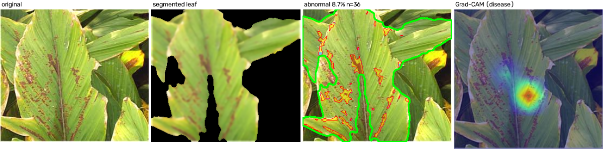

# Image Processing + CNN for Disease Detection in Turmeric and Black Gram

> Generated by `scripts/make_report.py` from files in `results/` and `data/processed/`. No number in this report is typed by hand; `results/report_numbers.json` lists the source of each.

**Research question.** Can conventional digital image-processing techniques identify disease-related characteristics in turmeric and black gram leaves, and how does their performance compare with a CNN-based approach?

## Data

Public datasets (Mendeley Data, sha256-verified on download; see README):

- **Black gram:** Talasila et al., Black gram Plant Leaf Disease (BPLD) dataset, Data in Brief 45 (2022) 108725, doi:10.17632/zfcv9fmrgv.3
- **Turmeric:** A data-driven approach to turmeric disease detection: Dataset for plant condition classification, Data in Brief 59 (2025) 111435, doi:10.17632/g46dvrcvwn.2 - original images only (the pre-augmented archive is not used).

| Crop | Original class | Label | Images | Train | Val | Test |
|---|---|---|---|---|---|---|
| blackgram | anthracnose | diseased | 230 | 169 | 31 | 30 |
| blackgram | healthy | healthy | 221 | 155 | 34 | 32 |
| blackgram | leaf_crinckle | diseased | 152 | 108 | 23 | 21 |
| blackgram | powdery_mildew | diseased | 180 | 115 | 31 | 34 |
| blackgram | yellow_mosaic | diseased | 224 | 158 | 33 | 33 |
| turmeric | dry_leaf | diseased | 203 | 150 | 28 | 25 |
| turmeric | healthy_leaf | healthy | 197 | 138 | 30 | 29 |
| turmeric | leaf_blotch | diseased | 199 | 132 | 32 | 35 |

Total readable leaf images: 1606 (unreadable: 0). Rhizome/root classes of the turmeric dataset are excluded.

**Leakage control.** Near-duplicates are clustered with perceptual hashes at two resolutions over all flip/rotation variants plus consecutive-file-number (burst shot) grouping; whole clusters are assigned to train/val/test (stratified by crop x label, seed 42). Clusters: 1548, of which 50 contain more than one image; clusters spanning two splits: 0.

**Capture conditions.** Share of images photographed on a plain card/paper/cloth (Stage 1 plain-background mode): 
- blackgram healthy: 91 of 221
- blackgram diseased: 186 of 786
- turmeric healthy: 197 of 197
- turmeric diseased: 401 of 402

## Methods

```
              LEAF IMAGE
                  |
        +---------+---------+
        v                   v
  IMAGE PROCESSING         CNN
        v                   v
  regions + features   learned features
        v                   v
  rule score / SVM     CNN classifier
        +---------+---------+
                  v
          HEALTHY / DISEASED
```

**Stage 1 - digital image processing (core).** Resize, median + Gaussian denoising, CLAHE on L*; leaf segmentation in two modes chosen from the image border (plain background: k-means background colour model in Lab + Otsu threshold on colour distance; field background: GrabCut with a centre prior); morphology and dominant-component selection with hole filling. Abnormal regions: yellow / brown / dark / pale colour rules relative to each leaf's own green reference, hysteresis growth, opening/closing and connected components. Features (listed in `results/feature_list.txt`): colour statistics over leaf and lesions (RGB/HSV/Lab), abnormal-colour %, GLCM contrast / energy / homogeneity / correlation / dissimilarity, edge density, lesion count / area / perimeter / circularity / mean and max size, leaf solidity. Decisions: (a) a fixed-weight rule score over affected-%, lesion count, abnormal-colour % and GLCM contrast with a per-crop threshold chosen on VAL; (b) an RBF SVM tuned by grouped cross-validation on TRAIN.

**Stage 2 - CNN (hierarchical, Phase 2).** Crop: openclip_vitb32 head x zero-shot prior (selected on wild_val among DINOv2, OpenCLIP and EfficientNet-B0 candidates; see models/MODEL_CARD.md). Disease: mobilenet_v2 with one diseased/healthy logit per crop, trained with background-swap augmentation (leaves composited onto backgrounds of either crop) so the photo style carries no crop information. Both are temperature-calibrated; an out-of-distribution score (DINOv2 nearest-neighbour distance) routes unusual photos to 'uncertain'. Disease CNN epochs run: 16; best epoch 11 (VAL macro-F1 0.964); training time 3.6 min on `mps`. The v1 4-class MobileNetV2 is kept for the before/after comparison.

## Stage 1 checks

- Segmentation: 99.0% of 100 random train/val images give a single dominant leaf mask covering 5% to 95% of the frame.
- Abnormal-region detection (240 train/val images): mean affected area 3.32% on healthy vs 41.72% on diseased leaves.


## Results

### Stage 1 decisions

**Rule-based score - VAL**

| Scope | n | Accuracy | Precision | Recall | F1 | Macro-F1 | ROC-AUC |
|---|---|---|---|---|---|---|---|
| overall | 242 | 0.888 | 0.927 | 0.921 | 0.924 | 0.857 | 0.905 |
| blackgram | 152 | 0.868 | 0.938 | 0.890 | 0.913 | 0.821 | 0.876 |
| turmeric | 90 | 0.922 | 0.908 | 0.983 | 0.944 | 0.908 | 0.967 |

**Rule-based score - TEST**

| Scope | n | Accuracy | Precision | Recall | F1 | Macro-F1 | ROC-AUC |
|---|---|---|---|---|---|---|---|
| overall | 239 | 0.879 | 0.931 | 0.904 | 0.917 | 0.845 | 0.939 |
| blackgram | 150 | 0.820 | 0.903 | 0.864 | 0.883 | 0.746 | 0.879 |
| turmeric | 89 | 0.978 | 0.983 | 0.983 | 0.983 | 0.974 | 0.997 |

**SVM - VAL**

| Scope | n | Accuracy | Precision | Recall | F1 | Macro-F1 | ROC-AUC |
|---|---|---|---|---|---|---|---|
| overall | 242 | 0.963 | 0.972 | 0.978 | 0.975 | 0.952 | 0.991 |
| blackgram | 152 | 0.941 | 0.958 | 0.966 | 0.962 | 0.914 | 0.980 |
| turmeric | 90 | 1.000 | 1.000 | 1.000 | 1.000 | 1.000 | 1.000 |

**SVM - TEST**

| Scope | n | Accuracy | Precision | Recall | F1 | Macro-F1 | ROC-AUC |
|---|---|---|---|---|---|---|---|
| overall | 239 | 0.975 | 0.973 | 0.994 | 0.983 | 0.966 | 0.998 |
| blackgram | 150 | 0.960 | 0.959 | 0.992 | 0.975 | 0.938 | 0.995 |
| turmeric | 89 | 1.000 | 1.000 | 1.000 | 1.000 | 1.000 | 1.000 |

SVM hyperparameters (grouped CV on TRAIN): C = 10, gamma = 0.03; CV macro-F1 0.948. Rule thresholds from VAL: black gram 0.215, turmeric 0.235.

### CNN

**CNN healthy/diseased - VAL**

| Scope | n | Accuracy | Precision | Recall | F1 | Macro-F1 | ROC-AUC |
|---|---|---|---|---|---|---|---|
| overall | 242 | 0.975 | 0.994 | 0.972 | 0.983 | 0.969 | 0.998 |
| blackgram | 152 | 0.961 | 0.991 | 0.958 | 0.974 | 0.945 | 0.995 |
| turmeric | 90 | 1.000 | 1.000 | 1.000 | 1.000 | 1.000 | 1.000 |

**CNN healthy/diseased - TEST**

| Scope | n | Accuracy | Precision | Recall | F1 | Macro-F1 | ROC-AUC |
|---|---|---|---|---|---|---|---|
| overall | 239 | 0.996 | 0.994 | 1.000 | 0.997 | 0.994 | 1.000 |
| blackgram | 150 | 0.993 | 0.992 | 1.000 | 0.996 | 0.990 | 1.000 |
| turmeric | 89 | 1.000 | 1.000 | 1.000 | 1.000 | 1.000 | 1.000 |

4-class (crop x state) TEST accuracy 0.992, macro-F1 0.992; crop identification accuracy 0.996. Mean confidence when correct 0.995 vs when wrong 0.761.


## Comparison: image processing vs CNN (identical TEST split)

| Method | Scope | n | Accuracy | Macro-F1 [95% CI] | Precision | Recall (diseased) | Recall (healthy) | ROC-AUC |
|---|---|---|---|---|---|---|---|---|
| Rule-based (IP) | overall | 239 | 0.879 | 0.845 [0.789, 0.895] | 0.931 | 0.904 | 0.803 | 0.939 |
| SVM (IP features) | overall | 239 | 0.975 | 0.966 [0.938, 0.989] | 0.973 | 0.994 | 0.918 | 0.998 |
| CNN (disease MobileNetV2) | overall | 239 | 0.996 | 0.994 [0.982, 1.000] | 0.994 | 1.000 | 0.984 | 1.000 |
| Rule-based (IP) | blackgram | 150 | 0.820 | 0.746 [0.656, 0.821] | 0.903 | 0.864 | 0.656 | 0.879 |
| SVM (IP features) | blackgram | 150 | 0.960 | 0.938 [0.882, 0.981] | 0.959 | 0.992 | 0.844 | 0.995 |
| CNN (disease MobileNetV2) | blackgram | 150 | 0.993 | 0.990 [0.966, 1.000] | 0.992 | 1.000 | 0.969 | 1.000 |
| Rule-based (IP) | turmeric | 89 | 0.978 | 0.974 [0.934, 1.000] | 0.983 | 0.983 | 0.966 | 0.997 |
| SVM (IP features) | turmeric | 89 | 1.000 | 1.000 [1.000, 1.000] | 1.000 | 1.000 | 1.000 | 1.000 |
| CNN (disease MobileNetV2) | turmeric | 89 | 1.000 | 1.000 [1.000, 1.000] | 1.000 | 1.000 | 1.000 | 1.000 |

### Findings
1. **Ranking (macro-F1, overall):** CNN (disease MobileNetV2) 0.994, SVM (IP features) 0.966, Rule-based (IP) 0.845.
2. **SVM vs CNN (exact McNemar):** the SVM is right where the CNN is wrong on 0 images and the reverse on 5; p = 0.0625, so the difference is not statistically significant at alpha = 0.050.
3. **Black gram:** the SVM on hand-designed features (macro-F1 0.938, healthy recall 0.844) is lower than the CNN (0.990, healthy recall 0.969); the 95% bootstrap CIs overlap.
4. **Turmeric:** the SVM on hand-designed features (macro-F1 1.000, healthy recall 1.000) equals the CNN (1.000, healthy recall 1.000); the 95% bootstrap CIs overlap.
5. **By original class**, the largest CNN advantage over the SVM is on *black gram healthy* (CNN 0.969 vs SVM 0.844, n = 32); the SVM does not beat the CNN on any original class (it ties on *black gram anthracnose*, *turmeric dry leaf*, *turmeric healthy leaf*, *turmeric leaf blotch*, *black gram leaf crinckle*, *black gram yellow mosaic*).
6. **Rule-based score vs SVM:** the transparent four-measurement rule reaches macro-F1 0.845 (healthy recall 0.803) against 0.966 (healthy recall 0.918) for the SVM, which combines the full Stage 1 feature vector with a learned boundary. The four transparent measurements alone over-call disease on healthy leaves; the colour and texture statistics fix most of that.
7. **Interpretability and cost:** the image-processing route returns the affected-area %, lesion count and the segmented leaf / abnormal-region masks that explain each decision, at 70.1 ms per image on CPU versus 208.3 ms (CPU) / 148.5 ms (GPU) for the CNN. SVM and CNN agree on 0.979 of TEST images and are then right 0.996 of the time; the 5 disagreements are shown with both kinds of evidence in `figures/disagreements_gallery.png`.
8. **Crop identification:** the crop model names the crop correctly on 0.996 of TEST images.


## Leakage ablation
Apparent TEST accuracy when the split ignores near-duplicates (`naive_random`) or when augmented copies are created before splitting (`augment_then_split`, as in pre-augmented public datasets). SVM = Stage 1 features with the T06 hyperparameters; CNN head = logistic regression on frozen ImageNet MobileNetV2 embeddings.

| Scenario | Model | Accuracy | Macro-F1 | TEST items with a near-duplicate in TRAIN | Inflation vs clean (macro-F1) |
|---|---|---|---|---|---|
| clean | svm | 0.975 | 0.966 | 0.000 | 0.000 |
| clean | cnn_head | 0.987 | 0.984 | 0.000 | 0.000 |
| naive_random | svm | 0.963 | 0.951 | 0.054 | -0.015 |
| naive_random | cnn_head | 0.988 | 0.984 | 0.054 | 0.000 |
| augment_then_split | svm | 0.994 | 0.992 | 0.949 | 0.026 |
| augment_then_split | cnn_head | 0.993 | 0.991 | 0.949 | 0.007 |

With original images only, near-duplicates are rare in these datasets: 0.054 of naive-random TEST items have a near-duplicate in TRAIN, and macro-F1 moves by -0.015 (SVM) and 0.000 (CNN head). Creating augmented copies before splitting puts a sibling of 0.949 of TEST items in TRAIN and inflates macro-F1 by 0.026 (SVM) and 0.007 (CNN head): the weaker method gains more, so the gap between methods shrinks, which is how pre-augmented benchmarks can flatter weaker methods. Side note: on the clean split the frozen-embedding CNN head (0.984) is on par with the fine-tuned CNN (0.994).

## Error analysis

Per-original-class TEST accuracy (share of images classified correctly as healthy/diseased):

| Original class | n | Rule-based | SVM | CNN |
|---|---|---|---|---|
| anthracnose | 30 | 0.767 | 1.000 | 1.000 |
| dry_leaf | 25 | 1.000 | 1.000 | 1.000 |
| healthy | 32 | 0.656 | 0.844 | 0.969 |
| healthy_leaf | 29 | 0.966 | 1.000 | 1.000 |
| leaf_blotch | 35 | 0.971 | 1.000 | 1.000 |
| leaf_crinckle | 21 | 0.857 | 1.000 | 1.000 |
| powdery_mildew | 34 | 0.824 | 0.971 | 1.000 |
| yellow_mosaic | 33 | 1.000 | 1.000 | 1.000 |


SVM vs CNN disagreements with both kinds of evidence (original | Stage 1 abnormal regions | Grad-CAM):


## Answer to the research question

Hand-designed image processing does identify disease-related characteristics: abnormal-colour regions, lesion counts and texture separate healthy from diseased leaves well enough for an SVM to reach macro-F1 0.966 on unseen leaves. The CNN is higher by 0.028 macro-F1; the difference is not statistically significant (McNemar). Turmeric is close to solved by both routes on this paper-background dataset; black gram, photographed mostly in the field, is where hand-designed features fall short, mainly by calling healthy leaves diseased (see the healthy recall values above). The image-processing route buys an explicit, inspectable measurement of how much of each leaf is affected and why it was flagged; the CNN buys accuracy without feature design.

## Robustness: before (v1) vs after (Phase 2)

A user reported a turmeric field photo that v1 called black gram with high confidence. Diagnosis (`results/diagnosis.md`) found a capture-style shortcut: turmeric was always photographed on white paper and black gram mostly in the field. Phase 2 separates crop and disease, swaps backgrounds during training, calibrates confidence and abstains on unusual photos. wild_test = openly licensed photos from other sources (82 images, 62 with a disease label).

| Metric | Before (v1) | After (Phase 2) |
|---|---|---|
| Crop accuracy, clean TEST | 1.000 | 0.996 |
| Crop accuracy, wild_test | 0.927 | 1.000 |
| Accepted-crop precision, wild_test | 0.927 | 1.000 |
| Coverage, wild_test | 1.000 | 0.817 |
| Crop ECE, wild_test | 0.059 | 0.015 |
| Disease macro-F1, clean TEST | 0.978 | 0.994 |
| Disease macro-F1, wild_test (labelled) | 0.887 | 0.935 |
| SVM macro-F1, clean TEST | 0.935 | 0.966 |
| Rule macro-F1, clean TEST | 0.839 | 0.845 |

On the reported photo the crop is now turmeric with calibrated probability 1.000; Stage 1 finds 36 lesion regions instead of 1. Details: `results/robustness.md`.



## Limitations

- Both datasets come from single regions (Andhra Pradesh, India for black gram; Jamalpur, Bangladesh for turmeric) and single capture campaigns; no cross-region test was possible, so the measured accuracies are within-dataset estimates.
- All turmeric images are on white paper, while black gram mixes field and card photos; crop identity is therefore trivially predictable from the background, and the turmeric results say little about field photos.
- Turmeric 'Dry Leaf' is counted as diseased (abnormal condition class in the source dataset).
- Stage 1 colour rules were calibrated on TRAIN images of these two datasets; other cultivars, cameras or lighting may need recalibration. Weakest TEST classes by accuracy - SVM: healthy (0.844), powdery_mildew (0.971); CNN: healthy (0.969), anthracnose (1.000).
- Abnormal-region detection under-measures faint powdery mildew on dark leaves and very small dark spots (see the lesion figure and the disagreement gallery); the SVM partly compensates through colour and texture statistics of the whole leaf.
- Segmentation of field photos can include neighbouring foliage or miss part of a two-tone leaf.
- The CNN was trained once (one seed) with a time budget; no architecture search.
- Phase 2 abstains: 18.3% of wild_test photos are routed to 'uncertain' (the user is asked for the crop), and the full analysis is slower than v1.
- Disease labels exist only for wild images of single leaves on white; field scenes are disease-unlabelled.

## Future work

- Specific-disease classification (e.g. turmeric leaf spot / blotch, black gram yellow mosaic) instead of healthy vs diseased.
- Cross-region testing with leaves photographed in other districts / seasons.
- On-device deployment (the Stage 1 pipeline and MobileNetV2 both run on CPU).
