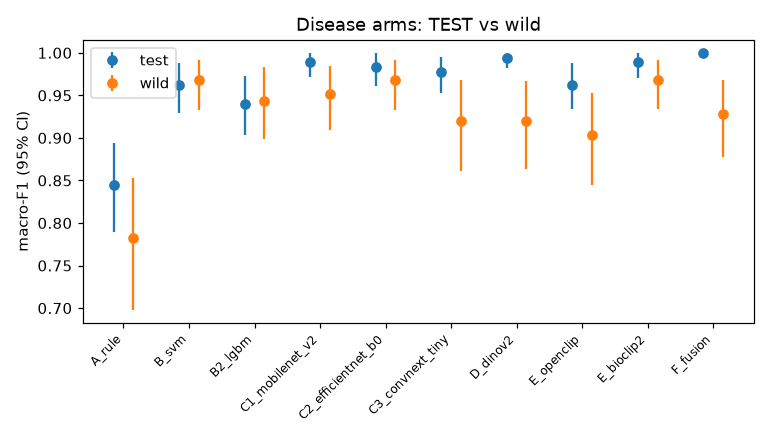
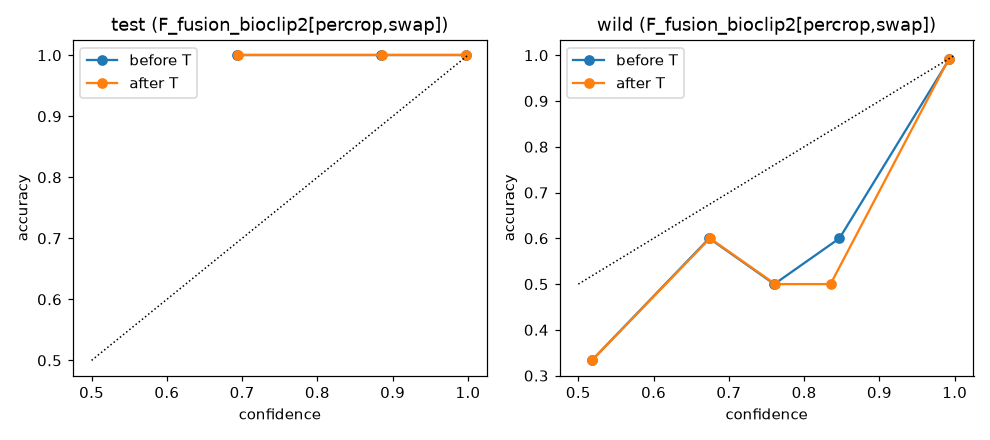
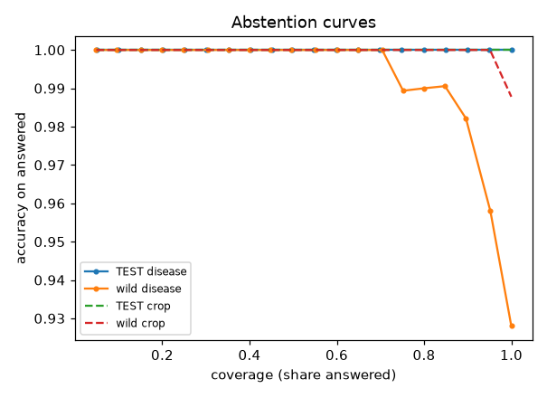
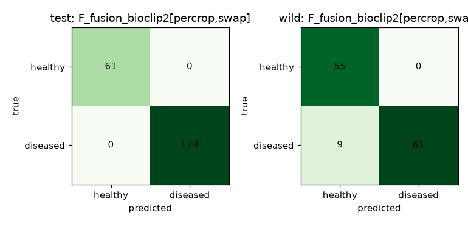

# Phase 3 final report: frozen backbones, fusion, calibrated abstention

Generated by `scripts/p3_report.py` from results/*.json. Do not edit by hand: `verify_all.py` re-renders this file and fails if it differs.

## Evaluation protocol

- Clean data: grouped split (perceptual-hash near-duplicate groups), 239 TEST images. Leakage check over train/val/test/wild/user: 0 near-duplicate groups span more than one role (1771 images hashed).
- Wild set: 125 disease-labelled images from two independent CC BY datasets (turmeric 55, black gram 70), plus crop-only field photos (iNaturalist / Commons) for crop ID: 164 images in all. Used for reporting only: no training, tuning, calibration or threshold fitting. `wild_test` is the half Phase 2 never used for its own selection.
- Selection: every choice (head, regime, data variant, arm, crop model) uses clean VAL plus VAL-swap (each VAL leaf composited onto a new background) as a non-wild robustness proxy. Temperatures and conformal thresholds are fitted on VAL + VAL-swap.
- CIs: 95% percentile grouped bootstrap, 1000 resamples by near-duplicate group.
- Wild CIs rest on 125 labelled images (55 turmeric / 70 black gram; wild_test about half of that) from two Bangladeshi datasets: treat them as unreliable.

## Disease arms (selected configuration per arm)

| arm | configuration | TEST macro-F1 [95% CI] | TEST AUC | TEST ECE | wild macro-F1 [95% CI] | wild AUC | wild ECE | wild_test macro-F1 | CPU ms/img |
|---|---|---|---|---|---|---|---|---|---|
| A_rule | `A_rule` | 0.845 [0.790, 0.894] | 0.941 | 0.082 | 0.782 [0.698, 0.853] | 0.946 | 0.065 | 0.772 | 523 |
| B_svm | `B_svm[pooled,swap]` | 0.962 [0.930, 0.988] | 0.998 | 0.032 | 0.968 [0.933, 0.992] | 0.998 | 0.065 | 0.951 | 523 |
| B2_lgbm | `B2_lgbm[pooled,swap]` | 0.940 [0.903, 0.973] | 0.989 | 0.025 | 0.944 [0.899, 0.984] | 0.996 | 0.053 | 0.919 | 523 |
| C1_mobilenet_v2 | `C1_mobilenet_v2[plain]` | 0.989 [0.971, 1.000] | 1.000 | 0.009 | 0.952 [0.910, 0.984] | 0.993 | 0.053 | 0.919 | 131 |
| C2_efficientnet_b0 | `C2_efficientnet_b0[swap]` | 0.984 [0.961, 1.000] | 1.000 | 0.013 | 0.968 [0.933, 0.992] | 1.000 | 0.026 | 0.951 | 543 |
| C3_convnext_tiny | `C3_convnext_tiny[plain]` | 0.978 [0.953, 0.995] | 1.000 | 0.012 | 0.920 [0.861, 0.968] | 0.996 | 0.072 | 0.935 | 2247 |
| D_dinov2 | `D_dinov2[percrop,swap]` | 0.994 [0.982, 1.000] | 1.000 | 0.010 | 0.920 [0.864, 0.967] | 0.979 | 0.055 | 0.887 | 33 |
| E_openclip | `E_openclip[percrop,swap]` | 0.962 [0.934, 0.988] | 0.998 | 0.019 | 0.903 [0.844, 0.952] | 0.990 | 0.065 | 0.886 | 35 |
| E_bioclip2 | `E_bioclip2[pooled,swap]` | 0.989 [0.971, 1.000] | 1.000 | 0.007 | 0.968 [0.934, 0.992] | 0.998 | 0.043 | 0.935 | 375 |
| F_fusion | `F_fusion_bioclip2[percrop,swap]` | 1.000 [1.000, 1.000] | 1.000 | 0.006 | 0.928 [0.877, 0.968] | 0.997 | 0.037 | 0.887 | 898 |

Per crop (wild macro-F1): A_rule turmeric 0.873 / black gram 0.708; B_svm turmeric 0.982 / black gram 0.957; B2_lgbm turmeric 0.982 / black gram 0.914; C1_mobilenet_v2 turmeric 0.982 / black gram 0.928; C2_efficientnet_b0 turmeric 0.964 / black gram 0.971; C3_convnext_tiny turmeric 0.854 / black gram 0.971; D_dinov2 turmeric 0.927 / black gram 0.914; E_openclip turmeric 0.891 / black gram 0.913; E_bioclip2 turmeric 0.982 / black gram 0.957; F_fusion turmeric 0.927 / black gram 0.928.

## Stacking vs best single arm (P3-M04)

Stacker: logistic regression over the calibrated log-odds of 10 arms, fitted on VAL + VAL-swap predictions. Best single arm by selection score: **F_fusion**.

| set | n | STACK macro-F1 [CI] | best arm macro-F1 [CI] | diff [CI] | McNemar p | verdict |
|---|---|---|---|---|---|---|
| test | 239 | 0.984 [0.962, 1.000] | 1.000 [1.000, 1.000] | -0.016 [-0.038, +0.000] | 0.250 | no significant difference |
| wild | 125 | 0.920 [0.863, 0.968] | 0.928 [0.877, 0.968] | -0.008 [-0.056, +0.041] | 1.000 | no significant difference |
| wild_test | 62 | 0.903 [0.822, 0.968] | 0.887 [0.806, 0.952] | +0.016 [-0.049, +0.085] | 1.000 | no significant difference |

Production disease model: **F_fusion** (stack not significantly better on both TEST and wild -> prefer the simpler single arm). Replaced after Phase 3 by the field-validated re-selection (last section but one).

## Crop identification (P3-M02)

| candidate | VAL+VAL-swap macro-F1 | TEST acc [CI] | wild acc [CI] | wild macro-F1 | wild ECE |
|---|---|---|---|---|---|
| dinov2_head | 0.993 | 1.000 [1.000, 1.000] | 1.000 [1.000, 1.000] | 1.000 | 0.011 |
| openclip_head | 1.000 | 1.000 [1.000, 1.000] | 0.951 [0.920, 0.976] | 0.951 | 0.036 |
| bioclip2_head (chosen) | 1.000 | 1.000 [1.000, 1.000] | 0.988 [0.963, 1.000] | 0.988 | 0.012 |
| concat_dinov2+bioclip2_head | 0.998 | 1.000 [1.000, 1.000] | 1.000 [1.000, 1.000] | 1.000 | 0.006 |
| openclip_zeroshot | 0.788 | 0.816 [0.766, 0.865] | 0.878 [0.822, 0.922] | 0.875 | 0.078 |
| bioclip2_zeroshot | 0.851 | 0.971 [0.949, 0.992] | 0.945 [0.903, 0.976] | 0.944 | 0.030 |
| openclip_head+bioclip2_zeroshot | 0.998 | 1.000 [1.000, 1.000] | 1.000 [1.000, 1.000] | 1.000 | 0.002 |

Chosen: `bioclip2_head` (temperature 1.00). No openly licensed 'other' training images in the repository; 'other' handled by the zero-shot prompt and the kNN OOD gate.
Wild crop errors are listed in results/crop_errors.md.
User-reported Google turmeric image: P(turmeric) 1.000, crop set ['turmeric'], OOD distance 0.249 -> outcome **turmeric**.

## Trust layer (P3-M05)

Split conformal (LAC), target coverage 90%; kNN OOD on DINOv2 (k=10, threshold = 95% quantile of VAL distances = 0.388); quality gate (blur, exposure, leaf area).

| set | n | crop coverage (conformal) | crop sets empty / singleton | disease coverage (conformal) | disease mean set size | OOD flag rate | answered after all gates | crop acc. answered | disease acc. answered | end-to-end acc. answered |
|---|---|---|---|---|---|---|---|---|---|---|
| test | 239 | 0.895 | 0.105 / 0.895 | 0.967 | 0.967 | 0.000 | 0.870 | 1.000 | 1.000 | 1.000 |
| wild_all | 164 | 0.805 | 0.195 / 0.805 | 0.800 | 0.808 | 0.116 | 0.610 | 1.000 | 0.987 | 0.987 |

Abstention reasons: test: crop uncertain 25, disease status uncertain 6; wild_all: crop uncertain 26, disease status uncertain 18, ood 17, quality 3.
Quality gate pass rate: val 1.000, test 1.000, wild_all 0.982, user 1.000.

ECE before -> after temperature scaling (production disease arm, pooled): test 0.006 -> 0.006; wild 0.036 -> 0.037.

LAC sets for the crop are empty rather than two-label when the crop model is unsure: VAL is almost perfectly separable, so the conformal threshold is tiny; an empty or two-label set both mean "crop uncertain".

 

## Robustness (P3-M07)

### Background-swap + strong augmentation (with vs without)

| arm | TEST macro-F1 without -> with | wild macro-F1 without -> with | wild diff [CI] |
|---|---|---|---|
| B_svm | 0.983 -> 0.962 | 0.912 -> 0.968 | +0.056 [+0.008, +0.110] |
| B2_lgbm | 0.972 -> 0.940 | 0.944 -> 0.944 | +0.000 [-0.040, +0.042] |
| C1_mobilenet_v2 | 0.989 -> 0.994 | 0.952 -> 0.951 | -0.000 [-0.033, +0.032] |
| C2_efficientnet_b0 | 0.984 -> 0.984 | 0.920 -> 0.968 | +0.048 [+0.008, +0.098] |
| C3_convnext_tiny | 0.978 -> 0.995 | 0.920 -> 0.960 | +0.040 [+0.008, +0.077] |
| D_dinov2 | 0.994 -> 0.994 | 0.888 -> 0.920 | +0.032 [-0.016, +0.087] |
| E_openclip | 1.000 -> 0.962 | 0.928 -> 0.903 | -0.024 [-0.087, +0.032] |
| E_bioclip2 | 0.989 -> 0.989 | 0.968 -> 0.968 | +0.000 [-0.032, +0.032] |
| F_fusion | 0.995 -> 1.000 | 0.912 -> 0.928 | +0.016 [-0.040, +0.071] |

### Shortcut test (leaf-only vs full image; 'large' = drop > 0.1)

| model | TEST macro-F1 full / leaf-only | wild macro-F1 full / leaf-only | large drop |
|---|---|---|---|
| A_rule | 0.845 / 0.831 | 0.782 / 0.748 | no |
| B_svm | 0.962 / 0.962 | 0.968 / 0.976 | no |
| B2_lgbm | 0.940 / 0.930 | 0.944 / 0.968 | no |
| C1_mobilenet_v2 | 0.989 / 0.984 | 0.952 / 0.936 | no |
| C2_efficientnet_b0 | 0.984 / 0.978 | 0.968 / 1.000 | no |
| C3_convnext_tiny | 0.978 / 0.972 | 0.920 / 0.912 | no |
| D_dinov2 | 0.994 / 0.994 | 0.920 / 0.943 | no |
| E_openclip | 0.962 / 0.973 | 0.903 / 0.976 | no |
| E_bioclip2 | 0.989 / 0.978 | 0.968 / 0.928 | no |
| F_fusion | 1.000 / 0.983 | 0.928 / 0.944 | no |
| STACK | 0.984 / 0.973 | 0.920 / 0.928 | no |

Crop model `bioclip2_head`: TEST accuracy 1.000 full / 1.000 leaf-only; wild 0.988 / 1.000.
Few-shot adaptation: not run: the wild set is reserved for evaluation (no adaptation pool carved out).

### Ablation: handcrafted features in the fusion head

| backbone | regime | embedding only: TEST / wild macro-F1 | embedding + 57 features: TEST / wild macro-F1 |
|---|---|---|---|
| dinov2 | percrop,swap | 0.994 / 0.920 | 0.995 / 0.952 |
| openclip | percrop,swap | 0.962 / 0.903 | 1.000 / 0.904 |
| bioclip2 | percrop,swap | 0.989 / 0.928 | 1.000 / 0.928 |
## Extended field test set (evaluation only)

Built by `scripts/build_wild_ext.py` (data/wild_ext/labels.csv), scored by `scripts/p3_wild_ext.py` with the frozen Phase 3 bundle; nothing fitted on this set. 1199 disease-labelled target leaves in 928 near-duplicate / capture groups, 1349 target images in all (incl. whole black gram field scenes, crop label only), and 180 leaves of five other plant species. Note: labels come from the source datasets' authors and were not re-checked by an agronomist; all sources are from Bangladesh; pest classes (aphids, insect, flea beetle) are excluded.

| arm | macro-F1 [95% CI] | ROC-AUC | ECE | turmeric macro-F1 | black gram macro-F1 |
|---|---|---|---|---|---|
| A_rule | 0.715 [0.686, 0.742] | 0.800 | 0.093 | 0.877 | 0.657 |
| B_svm | 0.860 [0.840, 0.883] | 0.944 | 0.039 | 0.965 | 0.824 |
| B2_lgbm | 0.863 [0.842, 0.886] | 0.945 | 0.045 | 0.955 | 0.832 |
| C1_mobilenet_v2 | 0.804 [0.775, 0.829] | 0.905 | 0.116 | 0.900 | 0.768 |
| C2_efficientnet_b0 | 0.908 [0.888, 0.924] | 0.968 | 0.042 | 0.912 | 0.906 |
| C3_convnext_tiny | 0.880 [0.860, 0.901] | 0.957 | 0.075 | 0.807 | 0.908 |
| D_dinov2 | 0.834 [0.810, 0.857] | 0.914 | 0.086 | 0.938 | 0.797 |
| E_openclip | 0.896 [0.877, 0.915] | 0.946 | 0.046 | 0.955 | 0.875 |
| E_bioclip2 | 0.864 [0.843, 0.885] | 0.952 | 0.056 | 0.972 | 0.824 |
| F_fusion (production) | 0.870 [0.847, 0.891] | 0.951 | 0.063 | 0.929 | 0.849 |
| STACK | 0.903 [0.885, 0.922] | 0.970 | 0.072 | 0.900 | 0.905 |

Production model by source: mendeley:45djgf3p96 macro-F1 0.827 [0.791, 0.860] (n 500); mendeley:jtttfbx342 macro-F1 0.929 [0.890, 0.963] (n 318); mendeley:z55yrbmn2d macro-F1 0.875 [0.827, 0.916] (n 381).

Crop ID accuracy: all target images 0.997 [0.993, 0.999]; field scenes 0.993 (n 150); mendeley:45djgf3p96 0.994 (n 500); mendeley:jtttfbx342 1.000 (n 318); mendeley:z55yrbmn2d 1.000 (n 381).
Other plant species: 94% refused by the gates (quality 0, ood 126, crop uncertain 43); 11 of 180 were answered as turmeric or black gram.
End-to-end with every gate (F_fusion): answered 53% of labelled leaves; on those, crop accuracy 1.000, disease accuracy 0.967, end-to-end 0.967 (all leaves, no abstention: 0.880). Abstain reasons: disease status uncertain 211, crop uncertain 200, quality 98, ood 60.

What this adds to the 125-image wild set:

- The production model's macro-F1 is 0.870 here vs 0.928 on the small wild set: the small set was optimistic.
- 4 arm(s) score higher than the production model here (C2_efficientnet_b0, C3_convnext_tiny, E_openclip, STACK). The production model was fixed on validation data before this set existed; switching now would use this test set for selection, so it is reported, not acted on. A future model change should be chosen on a separate validation split of new field data (done: see the next section).
- Disease conformal coverage on these leaves is 0.691 against the 90% target: the guarantee holds for VAL-like data only.
- Quality gate pass rate on target images 0.927; the rejections are mostly small leaf crops cut from the 1024 px field scenes (low detail), not whole photos.

## Field-validated re-selection (pre-registered: docs/PLAN_field_validation.md)

The plan and the SHA-1 of every wild / wild_ext file (results/test_manifest.json) were committed before any field-validation data existed. A new validation split, data/field_val (`scripts/build_wild_ext.py --section field_val`), holds 911 disease-labelled leaves in 572 near-duplicate / scene / capture groups (blackgram/diseased 511, blackgram/healthy 230, turmeric/diseased 123, turmeric/healthy 47) and 158 leaves of other plant species, from the same CC BY sources as wild_ext but sharing no image, field scene or capture minute with wild or wild_ext (a `verify_all` check). Base models were not retrained: field_val only chose among the existing configurations and re-fitted temperature, conformal and OOD thresholds (`scripts/p3_reselect.py`). The test sets were then scored once (`scripts/p3_reselect_eval.py`).

| candidate (field_val) | macro-F1 | turmeric F1 | black gram F1 | CPU ms/img |
|---|---|---|---|---|
| `STACK_fv` | 0.946 | 0.924 | 0.951 | 3887 |
| `F_fusion_openclip[pooled,swap]` (chosen) | 0.930 | 1.000 | 0.915 | 558 |
| `F_fusion_openclip[pooled,orig]` | 0.923 | 0.993 | 0.908 | 558 |
| `C3_convnext_tiny[swap]` | 0.920 | 0.924 | 0.919 | 2247 |
| `F_fusion_dinov2[pooled,orig]` | 0.919 | 0.931 | 0.917 | 556 |
| `C2_efficientnet_b0[swap]` | 0.919 | 0.944 | 0.913 | 543 |
| `E_openclip[percrop,swap]` | 0.916 | 0.964 | 0.906 | 35 |
| `E_openclip[pooled,swap]` | 0.914 | 0.993 | 0.897 | 35 |
| `F_fusion_bioclip2[percrop,swap]` (Phase 3 production) | 0.891 | 0.951 | 0.877 | 898 |

Best point estimate: `STACK_fv` (0.946, grouped-bootstrap CI lower bound 0.929). By the pre-registered tie rule the fastest candidate at or above that bound was chosen: **`F_fusion_openclip[pooled,swap]`** (0.930). Field_val calibration: temperature 3.00; held-out conformal coverage over 5 grouped folds 0.92, 0.88, 0.90, 0.91, 0.90 (target 0.90); crop ID kept (field_val accuracy 0.993); kNN OOD threshold 0.414 (keeps 95% of field_val target leaves; refuses 60% of field_val other-species leaves on its own).

Leave-one-source-out check: without mendeley:45djgf3p96 the winner is `E_openclip[percrop,swap]`; without mendeley:jtttfbx342 the winner is `STACK_fv`; without mendeley:z55yrbmn2d the winner is `E_openclip[pooled,swap]`. **The winner changes with every source removed**: the choice depends on which field sources are in the validation split, so the specific configuration is not robustly better than its close rivals (OpenCLIP-based heads and the stack).

### Once-only test evaluation: new vs Phase 3 production

Test files verified against the frozen hashes: 1693.

| test set | n | Phase 3 macro-F1 [CI] | field-validated macro-F1 [CI] | paired diff [CI] | McNemar (new right / old right, p) |
|---|---|---|---|---|---|
| wild_ext | 1199 | 0.870 [0.847, 0.891] | 0.917 [0.900, 0.934] | +0.047 [+0.028, +0.069] | 86 / 33, p 1.3e-06 |
| wild | 125 | 0.928 [0.877, 0.968] | 0.960 [0.920, 0.992] | +0.032 [-0.018, +0.088] | 8 / 4, p 0.39 |

Verdict (pre-registered rule): **new model better on wild_ext**; production switched: **yes**. `models/manifest.json` now serves `F_fusion_openclip[pooled,swap]`; the Phase 3 bundle is kept as `models/manifest_phase3.json` and every Phase 3 section above describes it.

Trust layer on wild_ext, Phase 3 bundle vs field-validated bundle (`results/wild_ext_field.json`):

| | Phase 3 | field-validated |
|---|---|---|
| answered with every gate on | 53% | 77% |
| end-to-end accuracy on answered leaves | 0.967 | 0.966 |
| end-to-end accuracy, all leaves | 0.880 | 0.923 |
| disease conformal coverage (target 0.90) | 0.691 | 0.862 |
| other plant species refused | 94% | 85% |

The looser field_val OOD threshold answers more real leaves but refuses fewer other-species leaves (27 of 180 answered as turmeric or black gram). Disease conformal coverage on wild_ext is still below the 90% target: field_val and wild_ext come from the same sources but are not exchangeable (different scenes, sessions and class mix).

## Honest limitations

- Wild set size: 125 disease-labelled images from two Bangladeshi Mendeley datasets (labels by those datasets' authors, not re-verified by an agronomist); the crop-only iNaturalist/Commons photos have no disease label. CIs on wild are wide and the wild set does not cover all regions, seasons, cameras or diseases.
- Training data are lab-style photos (turmeric always on white paper; black gram partly on cards / cloth). Background-swap augmentation and frozen backbones reduce but do not remove the domain gap; see the shortcut test.
- VAL is used for head selection, temperature, conformal thresholds and the stacker: some optimism on VAL-derived numbers is expected; TEST and wild are untouched.
- Conformal coverage is guaranteed only for data exchangeable with VAL; on the wild set it is reported, not guaranteed.
- No negative ('not a crop leaf') training images: 'other' is handled by a zero-shot prompt and the OOD gate.
- MobileSAM segmentation (P3-M06) was skipped: no hand-checked leaf masks exist to compare against; the lesion U-Net was skipped (fewer than 50 hand-labelled lesion masks). Few-shot wild adaptation was not run.
- Severity grades (mild / moderate / severe) are a heuristic on Stage 1 affected area, not a validated scale.
- Licences: see docs/LICENSES.md (torchvision ImageNet weights carry ImageNet's research-use terms).

